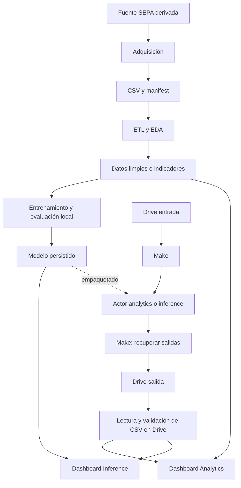

# Arquitectura, funciones y API
Un Actor, dos operaciones; Python comparte lógica con Streamlit. Make orquesta y Drive intercambia archivos. Entrenamiento separado.

Flujo implementado y documentado; la verificación completa de las corridas externas requiere evidencias. Adquisición mediante Actor está implementada como rama exclusiva de Analytics; validar con docente regla de entradas por SDK y excepción de extracción. No hay extracción en Inference. Streamlit admite archivos locales o lectura de CSV de Drive mediante cuenta de servicio o API key para acceso público autorizado. Selecciona el CSV compatible más reciente por fecha de modificación y mantiene caché de cinco minutos; permite actualizar desde la interfaz. Inference verifica compatibilidad del modelo con el hash del CSV. La lectura de Drive no implica reentrenamiento automático.

| Función / módulo | Input | Output |
|---|---|---|
| src/acquisition.py acquire | límites de lote y fragmentos | CSV y manifest |
| src/etl.py transform | lista de registros | limpio y calidad |
| src/eda.py analyze / analytics | filas limpias / crudas | indicadores / limpio, calidad e indicadores |
| src/signals.py feature_signals | DataFrame | Pearson e información mutua |
| src/inference.py preprocess | DataFrame | cinco columnas de entrada preparadas |
| scripts/train.py main | CSV limpio | pipeline persistido, metadata, residuos |
| src/inference.py predict | consulta, modelo, fecha | referencia, brecha, evidencia, escenario |
| src/commercial.py | indicadores y supuestos | oportunidades, insights, simulación y recomendaciones |
| src/operations.py execute | JSON | registros de almacenamiento |
| src/main.py | SDK de Apify | orquestación y persistencia |

## Contrato
POST /v2/acts/{actorId}/runs inicia operación. GET /v2/key-value-stores/{defaultKeyValueStoreId}/records/DOCUMENTACION recupera documentación después de una corrida, autenticada. GET de ejecución obtiene estado e ID de almacenamiento. No publicar tokens ni IDs privados sensibles. Este mecanismo debe comprobarse con el docente y con una corrida externa.

| Campo | Tipo | Descripción |
|---|---|---|
| operation | string | analytics / inference |
| batch_id | string | 1–80 caracteres ASCII, guion/guion bajo |
| origen | objeto | fuente del lote; hash requerido por la guía de Make |
| rows | array de objetos | valores escalares, 1–2500 filas; máximo 1 MB |
| adquirir_sepa | boolean opcional | Solo Analytics, sin rows; 50 observaciones/12 fragmentos |
| fecha_referencia | string opcional | ISO AAAA-MM-DD, por defecto fecha UTC |

Analytics recibe ofertas con identidad, fuente, fecha, comercio y precio. Devuelve OUTPUT, CAFE_CLEAN, QUALITY, ANALYTICS, DOCUMENTACION; adquisición añade CAFE_RAW y MANIFEST. Inference recibe formato, marca, canal, dimensión aplicable, precio propuesto opcional y supuestos comerciales opcionales; devuelve INFERENCE, OUTPUT y DOCUMENTACION. OUTPUT: status ok/parcial/sin_resultados, batch_id, conteos, claves y versión de modelo cuando corresponde. Estado SUCCEEDED de Apify no garantiza status ok del negocio.

Recursos iniciales de prueba: 512 MB/120 s, no capacidad demostrada. Ver [Apify](APIFY.md), [Make](MAKE.md), [Drive](DRIVE.md), [integración](../INTEGRACION_PASO_A_PASO.md).
